<p align="center">
  <a href="https://avivlevi01.github.io/"></a>
</p>

<p align="center">
  <a href="https://avivlevi01.github.io/"></a>
</p>

**This site is updated automatically by scripts and AI agents after changes in my projects.** It is the personal portfolio of Aviv Levi, a junior full-stack developer, in Hebrew and English.

## 🔄 How it updates itself

<p align="center">
  
</p>

1. **Code changes.** I push to one of my public repositories.
2. **Nightly agent.** A scheduled [Claude Code](https://claude.com/claude-code) agent runs in the cloud every night (around 01:00 Israel time) and looks for new or updated projects. If nothing changed, it does nothing.
3. **Update.** It refreshes the project cards (Hebrew and English) and my one-page resume, using only public facts from the repositories.
4. **Checks.** The change goes to the `auto-update` branch first. Before publishing: the resume is exactly one page, `script.js` passes a syntax check (when Node is available), new texts have an English translation, and only the expected files changed.
5. **Live.** If every check passes, the branch is fast-forwarded into `main`, GitHub Pages deploys it, and I get a summary email. If a check fails, nothing is published and the change waits for me.

Changes are picked up on the next nightly run, not instantly. Any push to `main` is deployed by GitHub Pages.

## ✨ What's on the site

| | |
|---|---|
| 🌍 **Two languages** | Hebrew by default with an English toggle, including right-to-left and left-to-right layouts |
| 🏔️ **Mountain scenery** | Ridges generated in code, falling snow, and a hiker who climbs to the summit |
| 🎠 **Projects carousel** | Arrows, dots, keyboard and swipe |
| 📬 **Contact form** | Delivered by email through Google Apps Script, with a `mailto:` fallback and a WhatsApp button |
| ♿ **Reduced motion** | Animations respect `prefers-reduced-motion` |

## 🛠️ Run it locally

Plain HTML, CSS and JavaScript. No build step and no packages to install.

```bash
git clone https://github.com/Avivlevi01/Avivlevi01.github.io.git
cd Avivlevi01.github.io
python -m http.server 5173
```

Then open `http://localhost:5173`.

| File | What it holds |
|---|---|
| `index.html` | Page structure and the Hebrew text |
| `script.js` | English text, animations, carousel and contact form |
| `styles.css` | Design and responsive layout |
| `assets/` | Photos, resume, recommendation letter and README graphics |
